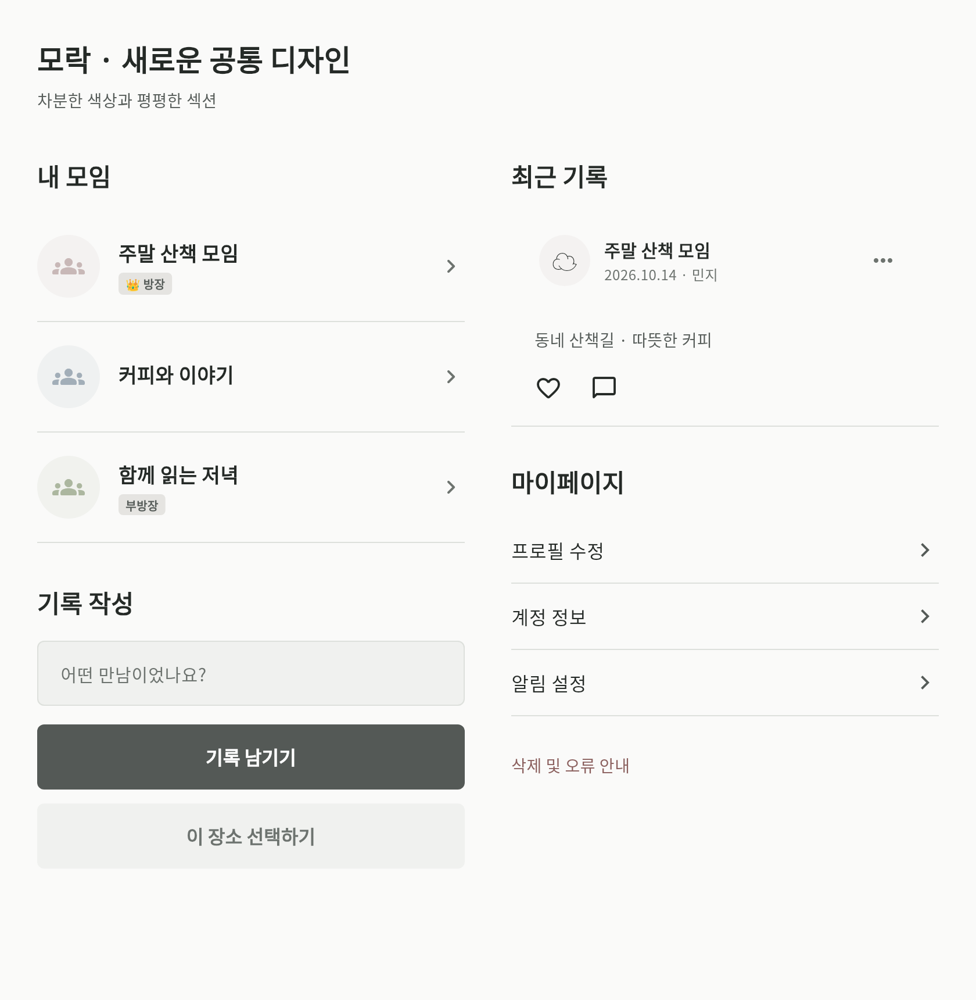

# 모던·저채도 디자인

`feature/modern-muted-design`은 최신 develop을 기준으로 만들고, 아직 develop에 합쳐지지 않은 `feature/restore-screens-and-improve-map-picker`의 마지막 커밋 `085bb6c`까지 포함한다. 지도 수정, 로그인/홈 복원과 기존 기능을 유지한 상태에서 디자인만 수정했다.

- 화면과 콘텐츠의 바탕을 같은 회백색으로 통일했다. 피드, 모임, 프로필 메뉴와 기록 상세는 큰 둥근 카드·개별 테두리 대신 여백과 하단 구분선으로 나눈다.
- 배너, 통계, 사진 영역, 다이얼로그와 바텀시트의 큰 모서리 둥글기와 그림자를 제거했다. 버튼과 입력창만 6px의 작은 모서리를 사용한다. 프로필 아바타와 작은 상태 표시의 원형은 유지한다.
- 지도 결과창은 좌우/아래 가장자리에 붙는 평평한 패널이다. 확대 버튼과 위치 핀도 공통 색상으로 정리했다.
- `AppTheme.light`에서 Material 표면, 메뉴, 다이얼로그, 바텀시트, 선택 요소의 색상을 통일했다. 브랜드 차콜 회색, 보조 회청색, 삭제/오류의 탁한 적갈색을 사용한다.
- 색상 선택 팔레트는 저채도로 바꿨다. 기존 저장된 모임 색은 `ColorUtils.displayThemeColor`로 표시할 때만 채도를 제한한다. 원본 색상 파싱과 저장값은 유지하고 DB 데이터를 변경하지 않는다.
- 로그인 소개 일러스트는 렌더링 시 채도만 낮췄다. 사진·공식 Google 로고·앱 런처 아이콘의 원본 파일은 수정하지 않았다.

실제 공통 컴포넌트를 샘플 데이터로 렌더링한 미리보기:

검증: 전체 Flutter 테스트 135개 통과. 마지막 색상 대비·로그인 이미지 수정 후 관련 화면 테스트와 미리보기 렌더링 11개 통과. Flutter 분석 오류/경고 0(기존 info 26개), 최신 웹 릴리스 빌드 성공. 본문 6.65:1, 공통 보조 텍스트 4.64:1 이상의 대비를 확보했다. Android/iOS 네이티브 빌드와 지도 마커 tint의 실기기 표시는 이 환경에서 확인하지 못했다.

이번 디자인 변경에 추가 SQL이나 검색 함수 변경은 없다.
